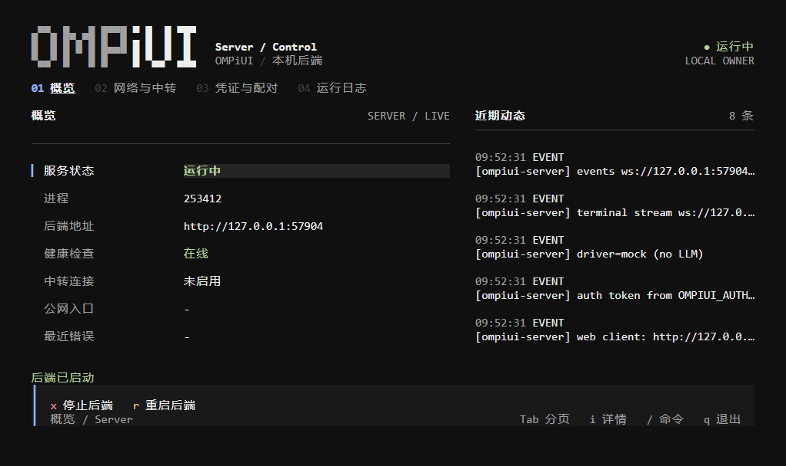
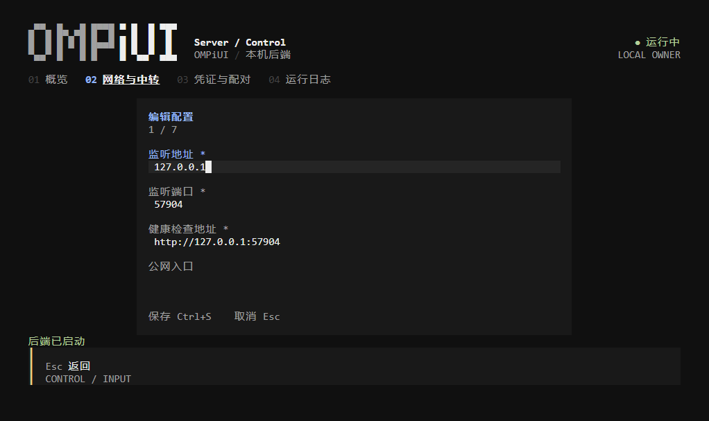
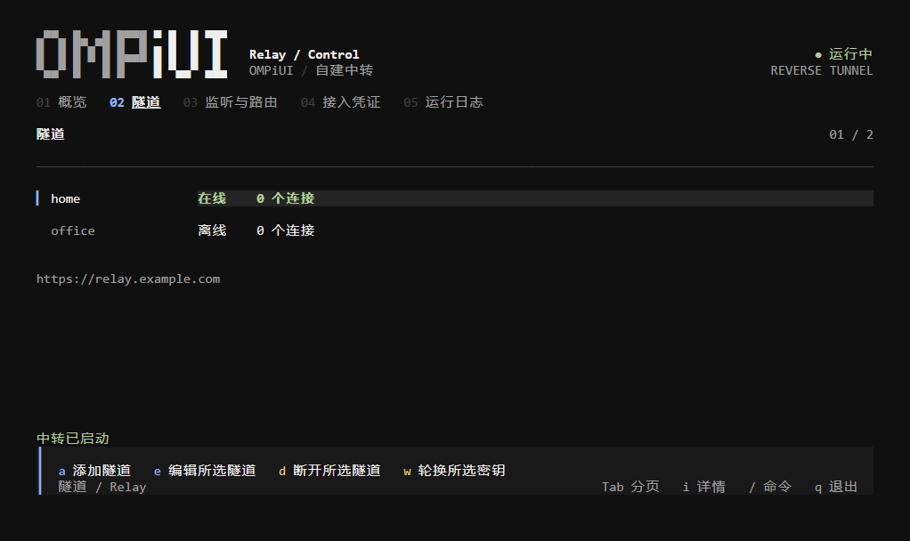
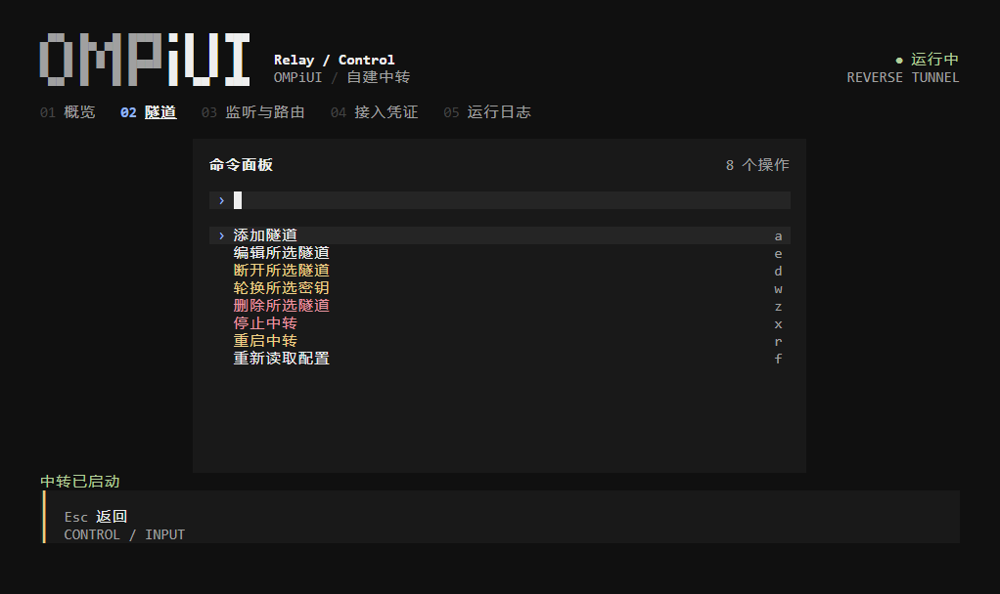

# OMPiUI

**在电脑、手机和浏览器中使用 OMP 编程助手。**

OMPiUI 是 [oh-my-pi (OMP)](https://github.com/can1357/oh-my-pi) 的第三方客户端。你可以在桌面上管理编程任务，也可以用手机连接电脑或服务器，继续同一个项目。

桌面端将界面、OMPiUI 后端和官方 OMP 运行时一起打包；手机端只负责界面，任务始终在连接的电脑或服务器上执行。另有两套终端管理界面，分别管理无头后端和自建公网中转。

[下载安装](https://github.com/chenming0v0/OMPiUI/releases) · [服务器部署](deploy/README.md) · [自建中转](docs/tunnel.md) · [TUI 使用指南](docs/tui.md)

## 可以做什么

- **编程任务**：对话、查看工具执行结果、使用模型与子代理，以及 OMP 的 MCP、LSP 和扩展能力。
- **继续已有任务**：与官方 `omp` 共用原生会话，终端和 OMPiUI 中的任务可以互相打开并继续。
- **桌面使用**：支持 Windows、macOS 和 Linux，打开界面后自动启动内置后端，标题栏可查看本机服务状态。
- **手机连接**：Android 客户端支持扫码或粘贴配对信息，手机浏览器也可直接访问后端分享的地址。
- **远程访问**：使用局域网、自己的公网入口，或自建中转连接内网电脑。
- **终端管理**：无需桌面环境，就能查看状态、管理服务启停、调整网络配置和管理中转隧道。

## 选择使用方式

| 你想怎么用 | 从哪里开始 |
| --- | --- |
| 在自己的电脑上编程 | 下载桌面安装包，配置模型与凭据后使用内置官方 OMP |
| 用手机连接电脑 | 安装 Android 客户端，或用手机浏览器打开电脑分享的地址 |
| 让任务在 Linux 服务器上运行 | 按 [无桌面部署指南](deploy/README.md) 安装后端，再用手机或浏览器连接 |
| 电脑没有公网 IP，但需要从外面连接 | 在自己的 VPS 上部署 [公网中转](docs/tunnel.md) |
| 通过 SSH 管理后端或中转 | 使用下面的两套 TUI |

桌面发布覆盖 Windows x64、macOS Apple Silicon 和 Linux x64；移动端提供 Android 安装包。iPhone 可以使用浏览器，目前没有正式发布的 iOS 安装包。

## 桌面与手机

1. 从 [Releases](https://github.com/chenming0v0/OMPiUI/releases) 下载适合系统的安装包。
2. 在**实际执行任务的电脑或服务器**上配置模型和登录凭据；沿用官方 OMP 的 `~/.omp/agent/models.yml`、`config.yml`，已有配置可直接使用。

3. 打开 OMPiUI 桌面端，等待本机后端就绪，然后打开项目、创建或继续任务。
4. 手机连接时，在电脑的「设置 → 服务」中生成配对信息，再到手机的认证页扫码或粘贴。

桌面安装包包含 OMPiUI 前后端，以及 `omp-runtime/` 中的官方 `omp`、Bun 1.3.14、同版本官方 npm 源码包和当前平台完整生产／原生依赖；默认使用内置运行时，不要求全局 npm 包或全局 Bun。依赖在显式安装／打包时准备，浏览会话或启动服务不会隐式下载。

如需使用外部官方 CLI，可设置 `OMPI_OMP_BIN`（设为 `omp` 时从 `PATH` 选择）；它必须有与实测 CLI 版本完全一致的官方源码及依赖，不能只安装一个不同版本的全局包。预装运行时目录、源码目录与 Bun 解释器的覆盖方式见 [运行配置](docs/development.md#运行配置)。Android 只连接电脑／服务器，不在手机本地执行 OMP。官方终端和 OMPiUI 继续共用原生会话目录，浏览与刷新只读，不创建会话写入进程。

手机必须能访问后端地址：同一局域网可启用局域网监听；跨网络连接请配置自己的 HTTPS 入口或中转，见 [远程访问](#远程访问)。

## 两套终端管理界面

在完成源码安装和构建后，在交互式终端中运行：

```bash
npm run tui:server
npm run tui:relay -- --config ./relay.config.json
```

### 后端管理

查看服务健康状态、进程和近期日志，启动、停止或重启后端，并查看手机配对凭证。



在「网络与中转」页编辑监听地址、端口、公网入口和中转连接；保存后重启后端生效。



### 中转管理

查看在线电脑和转发连接，添加或编辑隧道路由、轮换接入密钥，以及断开或删除隧道。



通过命令面板选择当前页面的操作，停止、重启、密钥轮换等操作会要求确认。



用 `Tab` 切换页面，`/` 打开命令面板，`s` 启动服务，`q` 退出。凭证默认隐藏，界面支持窄终端；完整操作见 [TUI 使用指南](docs/tui.md)。

**退出行为**：TUI 自己启动的后端或中转，在确认退出后会停止。后端 TUI 接入已有管理器时，退出不会停止原服务；中转 TUI 不接管独立运行的中转进程。长期无人值守运行请使用 systemd 或容器。

以上为实际 TUI 的终端截图，使用隔离的 mock 后端与演示隧道，不包含真实配对凭证。

## 从源码运行

需要 Node.js ≥ 22.19 和 npm；模型与凭据沿用官方 OMP 配置。先显式准备当前平台完整运行时，不需要全局安装 OMP npm 包或 Bun，启动时不会自动下载。

```bash
git clone -b dev https://github.com/chenming0v0/OMPiUI.git
cd OMPiUI
npm install
npm run prepare:omp-runtime
npm run build
node packages/server/dist/bundle-entry.js web --host 127.0.0.1 --port 8787
```

在浏览器中打开启动日志打印的访问链接，即可使用。默认只允许本机连接。

需要边改边调试时，在两个终端分别运行：

```bash
npm run dev:server:omp
npm run dev:app
```

## 远程访问

- **局域网**：后端使用 `--host 0.0.0.0`，再从「设置 → 服务」分享可访问的地址。不要在手机上使用电脑的 `127.0.0.1` 地址。
- **公网服务器**：配置 HTTPS 反向代理，并设置 `OMPIUI_PUBLIC_BASE_URL` 为对外地址。
  直连反代(不经中转)时还需设置 `OMPIUI_TRUSTED_PROXIES` 为反代 IP/CIDR,否则配对限速会把所有访客计为同一个反代地址,见 [中转部署指南](docs/tunnel.md#21-直连反代部署不经中转)。
- **内网电脑**：部署自己的中转，电脑主动连接中转，手机通过中转访问电脑。任务仍在电脑执行，见 [中转部署指南](docs/tunnel.md)。
- **无头服务器**：支持 systemd 和 Docker，也提供独立管理 Web UI，见 [服务器部署指南](deploy/README.md)。

**只向可信设备分享配对信息。** 访问令牌允许读写工作区、运行命令和驱动 Agent；公网连接必须使用 HTTPS。中转应由你自己部署和掌控。

## 更多文档

- [终端管理界面](docs/tui.md)：快捷键、配置、凭证与退出行为。
- [无桌面部署](deploy/README.md)：Linux、systemd、Docker 和管理 Web UI。
- [自建中转](docs/tunnel.md)：公网入口、TLS 和多电脑连接。
- [诊断日志](docs/diagnostics.md)：故障排查与报告导出。
- [开发与实现](docs/development.md)：源码结构、环境变量、验证与发版流程。
- [更新记录](CHANGELOG.md)。

## 致谢与许可证

界面源于 lehhair 的 [PiUI](https://github.com/lehhair/PiUI) 与 [OpenCodeUI](https://github.com/lehhair/OpenCodeUI)，Agent 能力由 [OMP](https://github.com/can1357/oh-my-pi) 提供。OMPiUI 不是上述项目的官方客户端。

许可证：GPL-3.0-only（继承 PiUI）。特别致谢：[LINUX DO](https://linux.do)。
