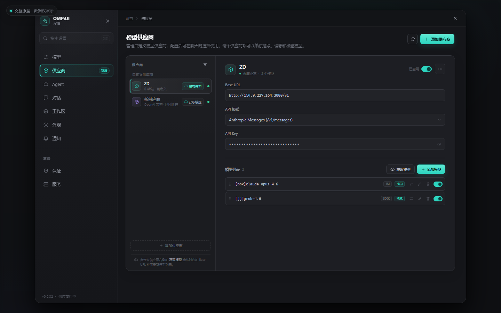
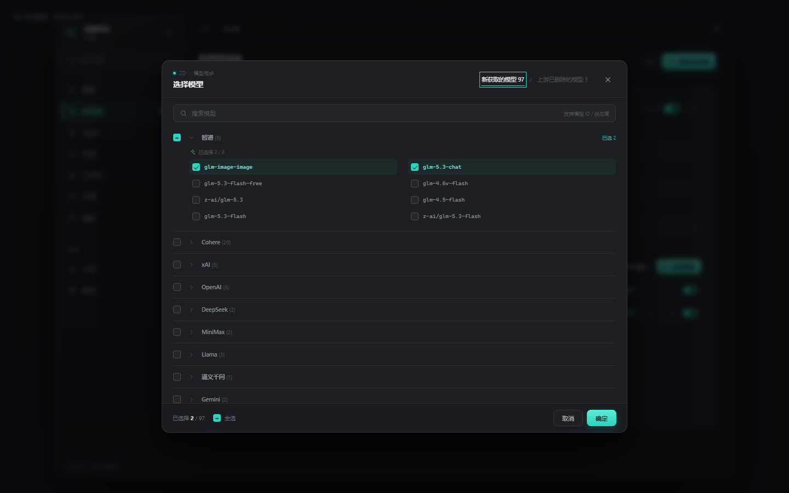
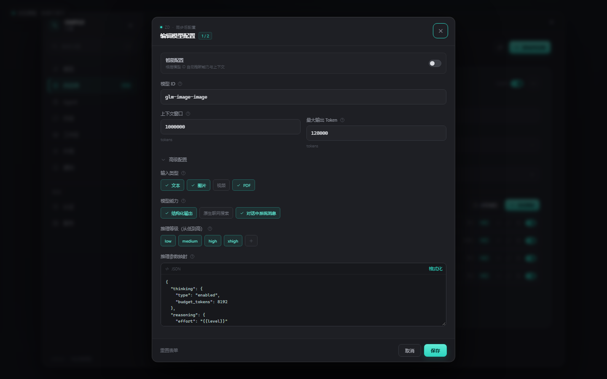

# 模型供应商设置 · 交互原型

这是独立的静态交互原型，**没有修改 OMPiUI 主应用代码**，用于先确认「供应商」入口、获取模型列表和模型编辑配置的交互。

## 打开方式

直接双击 `index.html`，或在仓库根目录启动任意静态服务器：

```bash
npx serve prototype/provider-settings
```

页面无外部依赖、不会发起真实网络请求，供应商和模型均为演示数据。

## 已覆盖的交互

- 设置侧栏中，在「模型」和「Agent」之间新增「供应商」入口。
- 供应商列表当前展示自定义供应商，状态点放在行尾；**每个自定义供应商行内各带一个独立「获取模型」按钮**。
- 获取模型时显示拉取状态，随后打开仿 NewAPI 的模型选择弹窗：
  - 新获取的模型 / 上游已删除的模型
  - 搜索、分组折叠、组选择、全选、已选数量
  - 确定后逐个进入模型配置
- 供应商详情支持 Base URL、API 格式（Anthropic / Chat Completions / Responses）、API Key 显示切换、启用开关。
- 模型列表支持手动添加、编辑、启停、删除。
- 模型配置弹窗覆盖截图中的字段：智能配置、模型 ID、上下文窗口、最大输出 Token、输入类型、模型能力、推理等级、推理参数 JSON 映射。
- 添加供应商、菜单、确认删除、Toast 等辅助流程。

## 预览







## 文件

- `index.html`：页面结构与弹窗模板
- `styles.css`：深色设置界面样式
- `app.js`：演示数据与全部交互逻辑

## 后续接入主应用时

建议把当前原型拆成：
1. `SettingsDialog` 的 `providers` tab 与侧栏入口；
2. 供应商列表 + 详情页组件；
3. 模型选择弹窗组件；
4. 模型配置表单组件。

接入时需要把 `app.js` 中的演示数据替换为服务端供应商/模型 API，并把两个入口（供应商行内「获取模型」、详情里的「添加模型」）分别接到真实拉取和手动创建流程。


